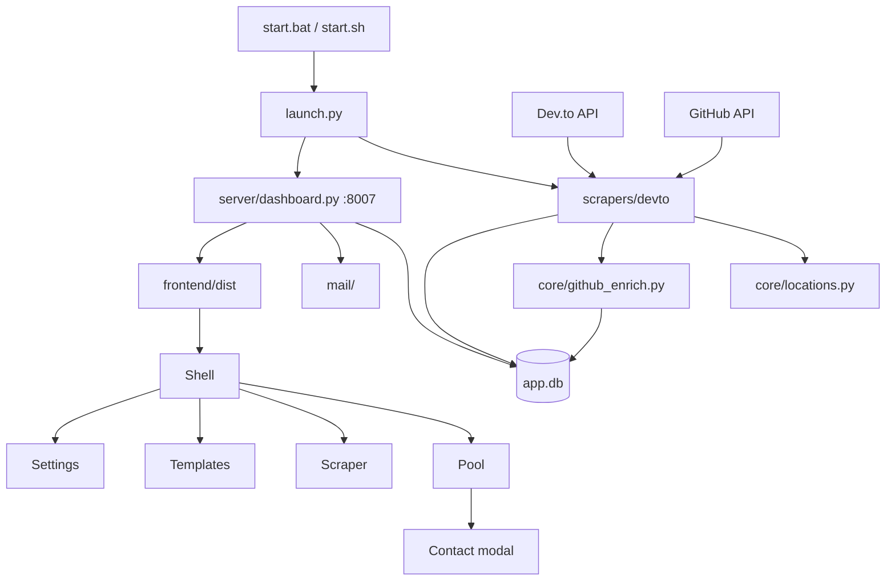

# Dev.to scraper + mail dashboard

`start.bat` / `start.sh` call `launch.py`. That process starts the Dev.to scraper and the dashboard on port 8007. Both read and write one SQLite file, `app.db`.



| Path | What it owns |
| --- | --- |
| `launch.py` | Starts `scrapers.devto` and uvicorn. Does not start a mail sender. |
| `scrapers/devto/` | Walks Dev.to user ids, normalizes location, stores a GitHub profile when the token allows it. |
| `core/db.py` | Users, contact status, sender addresses, mail templates, scrape position, and the GitHub token. |
| `core/github_enrich.py` | Token lookup, profile fields, and which hosts are social links. |
| `core/locations.py` | Place formatting and excluded countries. |
| `server/dashboard.py` | HTTP API and the built UI. |
| `mail/` | Renders `[Name]`, `[Your Name]`, and `[Link]` from the templates stored in `app.db`. |
| `frontend/src/app/` | Dashboard state and HTTP calls. |
| `frontend/src/features/` | Pool, Scraper, Templates, and Settings. The email and social modals live under Pool. |
| `exclude-regions.txt` | Country slugs the scraper will not save. |

The GitHub token, each sender’s name, and every mail template are rows in `app.db`. `app.db` stays on disk and is not part of the git history. Copy that file to keep users, senders, and templates together.

## Initial setup

Do this once on a new machine. After that, daily use is `start.bat` (or `./start.sh`).

### 1. Install runtimes

- **Python 3.10+**
- **Node.js 18+** (the launcher uses `npm` to install and build the UI)
- A **Gmail** account with an [App Password](https://support.google.com/accounts/answer/185833)

### 2. Put the project on disk

Clone or copy the repo. Open a terminal in that folder (the one that contains `start.bat`).

### 3. Create the project virtualenv

A local `.venv` is required. System Python is not used.

**Windows**

```bat
python -m venv .venv
.venv\Scripts\python.exe -m pip install -r requirements.txt
```

**Linux / macOS**

```bash
python3 -m venv .venv
.venv/bin/python -m pip install -r requirements.txt
```

You do not need to `npm install` by hand. The first `start` run does that and builds `frontend/dist`.

### 4. Settings

The GitHub token and sender names are saved on the **Settings** page after launch, in `app.db`. The token row shows the expiration GitHub reports, and marks the token expired when that date has passed or GitHub rejects it. Each sender address has its own name, which fills `[Your Name]` for the sender you pick. No app password is stored.

### 5. First launch

**Windows:** double-click `start.bat` (or run it from the project folder).

**Linux / macOS:** `./start.sh`

The launcher installs Python deps if needed, stops any previous instance from this project, builds the UI if it is missing or stale, then starts the scraper and dashboard in the same window.

Open **http://127.0.0.1:8007**

| What you want | Windows | Linux / macOS | URL |
| --- | --- | --- | --- |
| **Run the app** | `start.bat` | `./start.sh` | http://127.0.0.1:8007 |
| Edit the React UI with live reload | `start-watch.bat` or `start.bat watch` | `./start-watch.sh` | http://127.0.0.1:5173 |
| Stop everything | Ctrl+C, or `stop.bat` | Ctrl+C, or `./stop.sh` | — |

After code changes, run `start` again. It shuts the old processes down first. Template edits are saved in `app.db` and do not need a restart.

### 6. Optional: start 5 minutes after sign-in

From the project folder:

```bat
register-login.bat
```

That writes a script into this Windows user’s Startup folder. Five minutes after sign-in, it runs this copy’s `start.bat`. Sign-in is the session Windows opens after power-on. No admin rights. Undo with `register-login.bat remove`. Takes effect on the **next** sign-in.

### 7. Add a sender

1. In the UI, open **Settings**
2. **Add account**
3. Gmail address and the name that should fill `[Your Name]`
4. Save

Account age still sets the scrape cap. Tokyo calendar age raises each account’s cap at Tokyo midnight, and the scraper idles once today’s located saves reach that budget.

## Email templates

Templates are rows in `app.db`. Manage them on the **Templates** page. Restoring that database on a new install brings the templates back with the users and sender addresses. A new database starts empty; add templates on that page.

- Name: `{slug} (n).txt` — for example `apac (1).txt`, `japan (1).txt`, `usa (1).txt`
- Subject, then body
- Placeholders: `[Name]` (display name; missing → `there`), `[Your Name]` (the name saved for the selected sender), `[Link]`

**Named regions** (one template covers many countries): `eu`, `emea`, `apac`, `latam`, `etc` (Other).

**Countries** use the country name: `japan`, `usa`, `india`, `germany`. Typing `ja` / `jp` or `us` is treated as `japan` / `usa`.

The mail modal picks the first match: country template → named region → Other. Add APAC once and Asian/Pacific countries use it unless a country template exists.

## Exclude countries

`exclude-regions.txt` is a hand-edited skip list (one country slug per line). The scraper will not save those countries, the dashboard hides them, and matching users are deleted from SQLite.

Tiny countries that already had **fewer than 10** users were seeded here once. New small countries are **not** auto-added — otherwise they could never grow. Add a slug in the file (`iceland`, or a named region such as `eu` to drop every EU country), or click **−** next to a country in the Users sidebar. `#` starts a comment. `noloc` is not a country; do not list it.

Edits are picked up while scrape/dashboard are running.

## How to contact someone

1. **Scrape** — keep the app running so users accumulate. Dev.to resumes from its `last_id` parameter. Pause or change the daily located-save cap on the **Scraper** page.
2. **Settings** — add each sender address and the name that fills `[Your Name]`.
3. **Pool** — pick a country, or search by name or email. Open an email or a social icon, copy the rendered message, and mark it Sent, Failed, or Clear.
4. **Suppress** hides a person from the pool and keeps the email so a later scrape cannot add them again.

Mail is sent by hand. The dashboard does not queue or send messages.

### Scrape throttle

The scraper stays running but **idles** when today’s **located** saves (country ≠ `noloc`) reach the daily scrape cap. On the **Scraper** page, set that number and check **Apply daily cap**. Clear the checkbox to keep scraping with no daily limit. Saves tagged `noloc` still happen and do not count toward the budget.

The first startup copies the previous mail-based budget into that number once. Later sender changes do not move the scrape cap.
